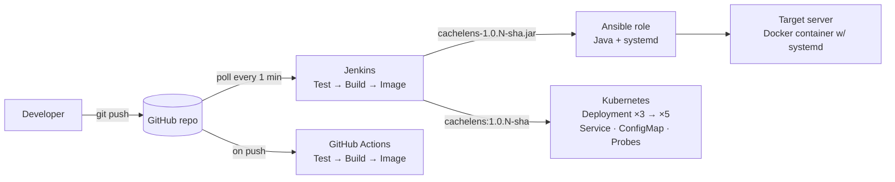

# CacheLens — CI/CD Pipeline & Kubernetes Deployment

**CacheLens** is a small REST API that simulates a fixed-size cache with a pluggable eviction policy (**LRU** or **LFU**).
Each write tells you which key got evicted, and stats report hit rate and eviction order. The same JAR goes through one pipeline end to end:



| Course 25CIAEC59 | What's in this repo |
|---|---|
| App | Spring Boot 3 / Java 17, 3 API endpoints + actuator, in-memory, no DB |
| Build | Maven (`pom.xml`), CI-friendly `${revision}` version |
| CI | `Jenkinsfile` (SCM polling, Test stage, archived artifact) + `.github/workflows/ci.yml` |
| **CI enhancements** | ① JUnit **test stage** before build ② **versioned artifacts**: `cachelens-1.0.<build>-<sha>.jar` and the Docker image tagged the same way ③ **GitHub Actions** alongside Jenkins |
| Config mgmt | `ansible/`: inventory, playbook, **role** `cachelens` (variables, **handler**, templates) |
| Container | Multi-stage `Dockerfile` (Maven build stage → JRE-only runtime, non-root) |
| Kubernetes | `k8s/`: Deployment (3 replicas), NodePort Service, ConfigMap |
| **Deploy enhancements** | ① **rollback demo** (`scripts/rollback-demo.sh`) ② **ConfigMap** for policy/capacity/port ③ **startup/liveness/readiness probes** ④ **multi-stage Dockerfile** ⑤ **/actuator/health + /actuator/prometheus metrics** |

## API

| Method | Path | Description |
|---|---|---|
| GET | `/` | Version and **which pod answered** (`instance`) |
| PUT | `/api/cache/{key}` | Body `{"value":"..."}` → returns `evicted` key, if any |
| GET | `/api/cache/{key}` | 200 + value on hit, 404 on miss |
| GET | `/api/stats` | policy, capacity, hits, misses, hitRate, evictions, evictionOrder |
| DELETE | `/api/cache` | Clear the cache |
| GET | `/actuator/health`, `/actuator/health/{liveness,readiness}` | Health for probes |
| GET | `/actuator/prometheus` | `cachelens_hits_total`, `cachelens_misses_total`, `cachelens_evictions_total`, `cachelens_size` |

Configuration (env vars): `APP_PORT` (8080), `CACHE_POLICY` (`LRU`/`LFU`), `CACHE_CAPACITY` (≥1, validated at startup).

## Quick start

```bash
mvn clean verify                                   # 8 JUnit tests + JAR in target/
java -jar target/cachelens-1.0.0-SNAPSHOT.jar
scripts/smoke-test.sh http://localhost:8080
```

The full walkthrough (Git → Jenkins → Ansible → Docker → Kubernetes, plus a screenshot checklist) is in [`docs/RUNBOOK.md`](docs/RUNBOOK.md).

## Design note: why each pod has its own cache

Every replica keeps its own in-memory cache, so after scaling to 5 pods, a `PUT` handled by pod A is a miss on pod B
(`scripts/spread.sh` shows the Service spreading requests across pods). This is on purpose. It shows why production
services keep pods **stateless** and put shared state in Redis/Memcached, which is the obvious next step for this project.

